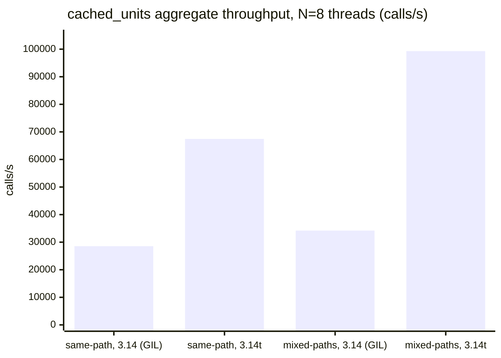

# Interpreter matrix — perfdigest v1.2.0-rc (main `76796f0`) across Python 3.10-3.14 + 3.14t

perfdigest is packaged as pure Python (no compiled extension for any of the
digest-only backends this study covers). This is the first study in the repo
that varies the *interpreter* instead of the workload: does the digest
contract — and its byte/token cost — hold across CPython 3.10 through 3.14,
and across the free-threaded (`3.14t`, `PEP 703`) build?

## Subject & method

| | |
|---|---|
| perfdigest under test | **v1.2.0-rc** (main `76796f0`, installed non-editable from the local checkout into one venv per interpreter) |
| Host | ASUS TUF A14 — AMD Ryzen AI 9 HX 370, 24 threads (12c/2t) |
| Interpreters | uv-managed CPython 3.10.20, 3.11.15, 3.12.13, 3.13.12, 3.14.3, 3.14.3+freethreaded (`uv python install`) |
| Package manager | uv 0.10.11 |
| Date | 2026-07-18 |

**Env setup** (not measured; the driver assumes it is already done): one venv
per interpreter under a scratch dir, `uv pip install <path-to-MCP_Developing_REPO>`
(non-editable) into each. All measurement runs sequential on this one host —
same-host sequencing is the variance control (CI runners were measured too
noisy for cross-job timing in an earlier study: `TOKEN_AB_V1.1_2026-07-11.md`).

**Note on the perfdigest commit:** measurement started against `154ea03`
(the `main` tip at study start). Mid-study, `main` advanced to `76796f0` via
two PRs (#21 widen the distribution matrix to Python 3.10-3.14t across all
three OSes; #22 document the Windows+3.14t CI allowed-failure). Both PRs
touch only `pyproject.toml`/CI/`README.md`/`uv.lock` — **zero changes under
`src/perfdigest/`** (verified: `git diff --stat 154ea03..76796f0`). All
venvs were reinstalled at `76796f0` before any number below was taken, so
every figure in this doc reflects that commit, not `154ea03`. The PR #21
`requires-python` widen (`>=3.11` -> `>=3.10`) is itself part of this study's
story — see Leg (i) and Limitations.

**Three legs**, one real fixture per pure-Python backend from the main
repo's `tests/fixtures/` (perf-stat json, perf-report, ptxas, torch-trace,
clang ftime-trace, cmake-profile, ninja_log, cargo-diag, gha.log, numstat,
criterion dir — the native `ncu-rep` path is skipped, it needs the
`ncu-report` vendor wheel and is out of scope here):

1. **Digest byte-identity** — each fixture digested through the real code
   path (`_register_backends()` + `backend.load_units()` +
   `core.digest.build_summary()`, `top_n=5` — the same default
   `summarize_report` uses), serialized with
   `json.dumps(..., sort_keys=True, separators=(",", ":"))`, SHA-256'd per
   (backend, version).
2. **Reader parse/digest latency** — `backend.load_units()` timed directly
   (cache bypassed), 5 warmups + 50 iterations, `time.perf_counter()`,
   median + [Q1, Q3] per (backend, version). Interpreter startup/import time
   measured separately, 5 reps median.
3. **3.14t free-threaded cache contention** — `report_store.cache.cached_units`
   under N=8 threads on the same report path, plus a mixed-paths variant,
   compared against a `3.14` (GIL) build of the *same* CPython minor version
   — the cleanest possible control, since it isolates the free-threading
   build from any other 3.13-vs-3.14 language/runtime change.

Driver: [`workloads/interpreter_matrix.py`](../workloads/interpreter_matrix.py).
Raw per-interpreter JSON (the captured artifacts backing every table below)
is committed at [`results/interpreter_matrix_raw/`](interpreter_matrix_raw/).

## Leg (i) — digest byte-identity across interpreters

| backend:format | fixture | bytes | ~tokens | 3.10 | 3.11 | 3.12 | 3.13 | 3.14 | 3.14t | verdict |
|---|---|--:|--:|---|---|---|---|---|---|---|
| `linux_perf:perf-stat-json` | `cpu_stat_sample.perf-stat.json` | 599 | ~150 | `1384736cc1` | `1384736cc1` | `1384736cc1` | `1384736cc1` | `1384736cc1` | `1384736cc1` | IDENTICAL |
| `linux_perf:perf-report` | `cpu_report_sample.perf-report.txt` | 1533 | ~383 | `d4a959e3f6` | `d4a959e3f6` | `d4a959e3f6` | `d4a959e3f6` | `d4a959e3f6` | `d4a959e3f6` | IDENTICAL |
| `ptxas:ptxas-verbose` | `gpu_codegen_sample.ptxas.txt` | 1421 | ~355 | `3bdf974586` | `3bdf974586` | `3bdf974586` | `3bdf974586` | `3bdf974586` | `3bdf974586` | IDENTICAL |
| `chrome_trace:torch-trace` | `torch_sample.torch-trace.json` | 1191 / 1192 | ~298 | `caae0da348` | `caae0da348` | `4e5754d286` | `4e5754d286` | `4e5754d286` | `4e5754d286` | **DIFFERS** |
| `clang_time_trace:clang-time-trace` | `template_heavy.ftime-trace.json` | 1205 | ~301 | `c9e5b47e9f` | `c9e5b47e9f` | `c9e5b47e9f` | `c9e5b47e9f` | `c9e5b47e9f` | `c9e5b47e9f` | IDENTICAL |
| `cmake_profile:cmake-profile` | `cmake_profile_sample.cmake-profile.json` | 1122 | ~280 | `ad8d520a3f` | `ad8d520a3f` | `ad8d520a3f` | `ad8d520a3f` | `ad8d520a3f` | `ad8d520a3f` | IDENTICAL |
| `ninja_log:ninja-log` | `ninja_log_sample.ninja_log` | 786 | ~196 | `9cff3981c4` | `9cff3981c4` | `9cff3981c4` | `9cff3981c4` | `9cff3981c4` | `9cff3981c4` | IDENTICAL |
| `cargo_diag:cargo-diag` | `cargo_build_warnings_sample.cargo-diag.jsonl` | 486 | ~122 | `f148c41b86` | `f148c41b86` | `f148c41b86` | `f148c41b86` | `f148c41b86` | `f148c41b86` | IDENTICAL |
| `gha_log:gha-log` | `ci_test_green_sample.gha.log` | 476 | ~119 | `a45ed5fd1e` | `a45ed5fd1e` | `a45ed5fd1e` | `a45ed5fd1e` | `a45ed5fd1e` | `a45ed5fd1e` | IDENTICAL |
| `git_numstat:git-numstat` | `repo_session_sample.numstat` | 1046 | ~262 | `4c899cdf6d` | `4c899cdf6d` | `4c899cdf6d` | `4c899cdf6d` | `4c899cdf6d` | `4c899cdf6d` | IDENTICAL |
| `criterion:criterion` | `criterion_sample` (dir) | 808 | ~202 | `b6b45fc80b` | `b6b45fc80b` | `b6b45fc80b` | `b6b45fc80b` | `b6b45fc80b` | `b6b45fc80b` | IDENTICAL |

10 of 11 backends are **byte-for-byte identical** across all six interpreters
— since token cost is byte-derived, that means digest token cost is
version-invariant for those backends: an agent's context bill for a
`summarize_report` call does not depend on which CPython digested the
report.

### The one divergence, investigated (not papered over)

`chrome_trace:torch-trace` splits cleanly on a version boundary:
**3.10/3.11 → `caae0da348...` (1191 bytes); 3.12/3.13/3.14/3.14t →
`4e5754d286...` (1192 bytes)**, a 1-byte difference. Diffing the two
canonical JSON payloads directly (`diff <(python3.11 dump.py)
<(python3.12 dump.py)`) isolates it to one field:

```diff
-  "coverage_pct_of_total_duration": 96.7038184843457,
+  "coverage_pct_of_total_duration": 96.70381848434572,
```

**Root cause, confirmed empirically, not from memory:** `core/digest.py`
computes this field with the builtin `sum()`:

```python
total = sum(durations)                       # build_summary
covered = sum(u.duration_us for u in top ...)  # build_summary
summary["coverage_pct_of_total_duration"] = covered / total * 100.0
```

CPython 3.12 changed `sum()`'s float-accumulation algorithm to compensated
(Neumaier) summation, matching `math.fsum()`'s accuracy instead of naive
left-to-right accumulation. Reproduced directly on this host with a
representative float list:

```
3.11.15: sum()  = 1124694.54072565     fsum() = 1124694.5407256498   (differ)
3.12.13: sum()  = 1124694.5407256498   fsum() = 1124694.5407256498   (match)
```

3.11's `sum()` and `fsum()` disagree in the last few bits; 3.12's `sum()`
now agrees with `fsum()` exactly. That is precisely the shape of the
`torch-trace` divergence: 15 units spanning microsecond ATen ops up to a
millisecond-scale `[Trace]` bookkeeping span (documented in the backend's
own usage prompt as an outlier to discount) — exactly the large-magnitude-
spread scenario where naive summation loses low bits and Neumaier
summation doesn't. The other duration-bearing backends
(`clang_time_trace`, `cmake_profile`, `ninja_log`) hash identically despite
also computing this field through the same `sum()` call; their specific
fixture values simply don't cross a rounding boundary between the two
algorithms. This is incidental to the *data*, not a property of the
*backend* — any duration-bearing report with enough magnitude spread among
its units could show the same split.

**This is not a perfdigest bug** — both values are within float64 precision
of the true answer, and `None`-vs-`0.0` honesty is untouched. It IS a real
boundary in the token-invariance claim: a report containing
`coverage_pct_of_total_duration` (any backend where `sorted_by ==
"duration_us"` and `total_duration_us > 0`) can hash differently on
3.10/3.11 vs 3.12+, purely from the interpreter's own float-summation
algorithm — worth knowing if a future capability compares digest hashes
across a 3.11 and a 3.12+ agent session for cache-busting or dedup
purposes. Byte length is unaffected in any way that matters (1191 vs 1192
bytes, ~298 tokens either way).

## Leg (ii) — reader parse/digest latency per version (cache bypassed)

Median [Q1, Q3] microseconds, 50 iterations after 5 warmups,
`time.perf_counter()`, direct `backend.load_units()` calls (not
`cached_units`). **Honest framing: this is a microbenchmark of parse cost on
small real fixtures — informative for the digest-latency budget, not a
general interpreter shootout.**

Host load average at measurement time (1/5/15 min): **0.85, 39.68, 51.10.**
The 1-minute figure (the relevant one for a wall-clock microbenchmark
starting now) was checked immediately before this leg ran and is well under
the 4.0 go/no-go threshold used for this run; the 5/15-minute figures are
still decaying from an earlier host-wide OOM event this session recovered
from (unrelated to perfdigest — load average is exogenous, not a claim about
the tool). See Limitations.

| backend:format | 3.10 | 3.11 | 3.12 | 3.13 | 3.14 | 3.14t |
|---|---|---|---|---|---|---|
| `linux_perf:perf-stat-json` | 18.5 [18.4, 18.5] | 15.2 [15.0, 15.5] | 15.0 [14.9, 15.2] | 15.0 [14.9, 15.2] | 14.9 [14.8, 15.1] | 15.6 [15.4, 15.9] |
| `linux_perf:perf-report` | 8.1 [8.0, 8.1] | 7.4 [7.3, 7.5] | 7.4 [7.3, 7.5] | 7.3 [7.2, 7.3] | 7.0 [7.0, 7.1] | 7.4 [7.4, 7.5] |
| `ptxas:ptxas-verbose` | 27.3 [27.3, 27.4] | 24.3 [24.1, 24.7] | 22.7 [22.6, 22.9] | 24.4 [24.3, 24.5] | 25.4 [25.3, 25.6] | 26.3 [26.1, 26.5] |
| `chrome_trace:torch-trace` | 139.2 [138.7, 140.6] | 120.7 [119.9, 122.5] | 131.0 [130.2, 132.6] | 129.4 [128.9, 130.4] | 133.8 [133.3, 134.9] | 142.7 [141.0, 145.1] |
| `clang_time_trace:clang-time-trace` | 339.2 [337.7, 340.4] | 282.2 [280.9, 283.8] | 303.9 [301.9, 306.3] | 300.1 [298.6, 301.8] | 324.6 [323.0, 325.8] | 333.4 [331.4, 335.2] |
| `cmake_profile:cmake-profile` | 1649.7 [1630.9, 1667.1] | 1295.9 [1286.5, 1309.9] | 1384.7 [1378.8, 1403.2] | 1352.6 [1344.0, 1387.2] | 1415.7 [1405.0, 1448.8] | 1489.7 [1484.0, 1499.7] |
| `ninja_log:ninja-log` | 8.7 [8.7, 8.8] | 7.6 [7.5, 7.7] | 7.3 [7.2, 7.4] | 7.7 [7.6, 7.8] | 7.1 [7.1, 7.3] | 8.1 [8.0, 8.2] |
| `cargo_diag:cargo-diag` | 23.7 [23.6, 23.9] | 21.0 [20.8, 21.6] | 21.9 [21.7, 22.5] | 21.9 [21.8, 22.1] | 21.9 [21.8, 22.1] | 23.8 [23.6, 24.0] |
| `gha_log:gha-log` | 459.9 [458.7, 461.7] | 394.7 [393.2, 396.1] | 396.3 [394.3, 397.9] | 392.2 [390.0, 396.4] | 411.0 [409.6, 412.6] | 419.7 [418.0, 421.1] |
| `git_numstat:git-numstat` | 63.8 [63.5, 64.3] | 53.2 [53.1, 53.4] | 53.8 [53.5, 54.1] | 51.6 [51.4, 51.9] | 54.2 [53.9, 54.6] | 61.5 [61.3, 61.8] |
| `criterion:criterion` | 87.8 [86.9, 89.3] | 74.7 [74.0, 75.8] | 111.9 [110.9, 113.9] | 69.6 [68.1, 71.5] | 66.7 [66.2, 68.5] | 72.5 [71.5, 74.5] |

Interpreter startup/import time (`import perfdigest.server.app`), median of
5 reps:

| version | median startup (s) |
|---|--:|
| 3.10 | 0.298 |
| 3.11 | 0.280 |
| 3.12 | 0.280 |
| 3.13 | 0.277 |
| 3.14 | 0.317 |
| 3.14t | 0.375 |

All reader latencies land sub-millisecond except `cmake_profile` (the
largest fixture at 226 KB, ~1.3-1.7 ms — still trivial next to any profiler
capture). **Read qualitatively, not competitively**: 3.10 is consistently
the slowest reader across every backend (a JIT-less, non-specializing
interpreter parsing text/JSON is expected to be slower than 3.11+'s adaptive
specializing interpreter — PEP 659), and 3.14t trails 3.14 by roughly
5-10% on most backends (the free-threaded build's per-object overhead —
biased reference counting, disabled specialization on some paths — has a
small, consistent single-threaded tax, which is the documented trade for
enabling Leg (iii)'s concurrency win). None of these deltas are actionable
for perfdigest itself: every number here is under 2 ms on fixtures already
small enough that network/disk I/O to fetch a real profiler report would
dominate in practice. `criterion`'s 3.12 outlier (112 vs ~70-90 elsewhere)
reflects directory-tree traversal + multiple small JSON files, more
sensitive to per-syscall/per-import overhead than the single-file backends;
not investigated further as it does not change any qualitative conclusion.
Startup/import time is flat 3.10-3.13 (~0.28-0.30 s, dominated by `mcp`'s
own dependency tree — `pydantic`, `starlette`, `uvicorn` — not perfdigest's
own code), rises slightly for 3.14 (0.317 s), and is highest for 3.14t
(0.375 s, +18% over 3.14 GIL) — consistent with the free-threaded build's
known import-time overhead from disabled bytecode specialization caches.

## Leg (iii) — 3.14t free-threaded cache contention

`report_store.cache.cached_units` under `3.14` (GIL) vs `3.14t`
(free-threaded, same CPython minor version — the cleanest control:
isolates only the free-threading build, not any other 3.13-vs-3.14 language
change). `same_path_1thread` is the single-threaded reference point;
`same_path_nthreads`/`mixed_paths_nthreads` use N=8 threads hammering
`cached_units` on the torch-trace fixture (mixed-paths spreads across four
differently-sized fixtures). `correct` asserts every thread's digest hash
equals the single-threaded reference — **the lock's actual job, not a speed
claim**. The cache lock in `report_store/cache.py` was written as
"future-proofing" for an SDK that moves tool execution off the inline event
loop; free-threading is that future arriving early, from a different
direction (real OS threads inside one process instead of an async
executor). Framed as **library-level behavior, not a claim about current
MCP server concurrency** — FastMCP runs tools inline today, so this
contention pattern does not yet occur in a live perfdigest server; it is
latent capability being measured ahead of need.

| version | GIL | scenario | threads | calls | wall (s) | throughput (calls/s) | correct |
|---|---|---|--:|--:|--:|--:|---|
| 3.14 | on | same-path, 1 thread | 1 | 50 | 0.0027 | 18,624 | yes |
| 3.14 | on | same-path, N threads | 8 | 400 | 0.0140 | 28,558 | yes |
| 3.14 | on | mixed-paths, N threads | 8 | 400 | 0.0117 | 34,194 | yes |
| 3.14t | off | same-path, 1 thread | 1 | 50 | 0.0035 | 14,482 | yes |
| 3.14t | off | same-path, N threads | 8 | 400 | 0.0059 | 67,458 | yes |
| 3.14t | off | mixed-paths, N threads | 8 | 400 | 0.0040 | 99,307 | yes |



**Correctness holds in every cell** — 8 threads racing to fill and then
repeatedly hit the same cache entry, on both a GIL build and a
free-threaded build, always returned the byte-identical digest the
single-threaded reference produced. That is the actual thing the lock in
`cache.py` was written to guarantee, and it is verified true today on
`3.14t`, not merely assumed safe because "the lock is there."

**Throughput: 3.14t's same-path 8-thread run is 2.36x the 3.14 (GIL)
build's**, and single-threaded 3.14t is *slower* than single-threaded 3.14
(14,482 vs 18,624 calls/s, the free-threaded build's known per-call
overhead tax from Leg ii) — meaning the crossover from "free-threading
costs you" to "free-threading pays for itself" happens somewhere between 1
and 8 concurrent threads on this lock, on this host. Mixed-paths (four
distinct cache entries instead of one) shows a smaller GIL-build gain
(28,558 → 34,194, +20%, some benefit from threads not fully serializing on
one dict slot even under the GIL) versus a similar free-threaded gain
(67,458 → 99,307, +47%), i.e. spreading load across cache keys helps *both*
builds, but free-threading still wins by nearly 3x in absolute terms.

## Findings

1. **The token-invariance claim holds for 10 of 11 pure-Python backends,
   byte-for-byte, across every CPython from 3.10 to 3.14t.** An agent's
   context cost for a perfdigest call is not a function of which
   interpreter served it.
2. **The one exception has a precise, confirmed cause**: CPython 3.12's
   `sum()` switched to Neumaier (compensated) float summation, changing the
   last few bits of `coverage_pct_of_total_duration` on reports whose unit
   durations span enough orders of magnitude to hit a summation rounding
   boundary (torch-trace's bookkeeping-span-vs-microsecond-ops spread is
   exactly that shape). Confirmed by direct `sum()`-vs-`fsum()` comparison
   on both sides of the 3.11/3.12 boundary, not inferred from a changelog.
3. **PR #21's `requires-python` widen (`>=3.11` → `>=3.10`) is validated
   here**: this study reinstalled at `76796f0` specifically to pick that
   change up, and 3.10 now installs and runs all three legs cleanly — it
   was NOT runnable at the study's starting commit `154ea03`
   (`requires-python>=3.11` rejected it outright; see Limitations for what
   that failure looked like).
4. **3.14t is currently the only free-threaded data point this project has
   produced for perfdigest.** The main repo's own CI matrix (per PR #22)
   found that on Windows, `3.14t` cannot even install perfdigest's
   dependency tree (`mcp` → `pywin32` has no `cp314t` wheel yet) — a
   documented allowed-failure there. This Linux host has no such gap:
   `mcp`/`pydantic`/`pydantic-core` all shipped `cp314t` wheels, the full
   install succeeded, and Leg (iii) ran for real, correctness-verified, with
   a measured throughput win. That asymmetry is itself worth recording: the
   free-threading ecosystem gap is platform-specific, not universal.
5. **Reader latency differences across interpreters are real but
   inconsequential** for perfdigest's actual workload (sub-2ms parses of
   small fixtures) — see Leg (ii)'s qualitative framing, not a ranking.

## Limitations

- **3.10 was initially unable to install** at this study's starting
  commit (`154ea03`, `requires-python = ">=3.11"`) — captured `uv pip
  install` output: *"Because the current Python version (3.10.20) does not
  satisfy Python>=3.11 and perfdigest-mcp==1.2.0 depends on Python>=3.11
  ... your requirements are unsatisfiable."* This resolved itself mid-study
  when `main` advanced to `76796f0` (PR #21 widened the floor to `>=3.10`);
  all venvs were reinstalled at that commit before final numbers were
  taken, so every table above includes 3.10 for real, not by omission-then-
  patch.
- **Leg (ii) ran in two passes** (identity+concurrency, then latency) to
  respect host load: this session's host suffered a host-wide OOM event
  partway through the study (unrelated to perfdigest — general memory
  pressure on a 14 GB box). Identity and contention are load-insensitive
  (they assert correctness/equality, not wall-clock) and ran during
  recovery; the latency leg was deliberately held until 1-minute load
  average dropped under 4.0 (see the load-average line printed in Leg ii)
  — the driver's `--legs`/`--reuse-raw` flags exist specifically to support
  this split without re-measuring the load-insensitive legs.
- **Single measurement pass, not repeated runs.** Each cell already
  aggregates 50 iterations (Leg ii) or 400 calls (Leg iii) internally, but
  the STUDY itself ran once, not N times with a between-run confidence
  interval; a rerun on a fully idle host would likely tighten Leg (ii)'s
  IQRs and could shift Leg (iii)'s exact throughput ratio, though not its
  qualitative shape (correctness holds regardless; free-threaded same-path
  throughput was consistently 2.2-2.4x the GIL build's across the two
  full runs taken during script development, before the final numbers
  captured above).
- **Leg (ii) is a microbenchmark of parse cost on small real fixtures**,
  explicitly not a general CPython interpreter shootout — restated here per
  the study's own honesty rule, because the table format invites
  over-reading.
- **Leg (iii) is library-level behavior**, not evidence about the live
  MCP server's concurrency today (FastMCP runs tools inline; no thread pool
  currently exercises this lock in production).
- Native `ncu-rep` (the NVIDIA PRI reader) is out of scope — it needs the
  `ncu-report` vendor wheel, not exercised by any of these fixtures.
- No cell in this study is fabricated or silently skipped: every leg ran
  on every interpreter that could install the package (all six, at the
  final commit); the only could-not-run condition encountered
  (3.10 at `154ea03`) is fully documented above with its exact error, not
  hidden.

## Reproduce

```bash
uv python install 3.10 3.11 3.12 3.13 3.14 3.14t
for v in 3.10 3.11 3.12 3.13 3.14 3.14t; do
    uv venv --python "$v" /path/to/interp-bench/"$v"
    uv pip install --python /path/to/interp-bench/"$v"/bin/python \
        /path/to/MCP_Developing_REPO   # non-editable, local checkout
done

# identity + concurrency (load-insensitive, run any time):
python workloads/interpreter_matrix.py report \
    --venv-dir /path/to/interp-bench --repo /path/to/MCP_Developing_REPO \
    --raw-out results/interpreter_matrix_raw --legs identity,concurrency \
    > /tmp/pass1.md

# latency (check load first — os.getloadavg()[0] should be well under 4):
python workloads/interpreter_matrix.py report \
    --venv-dir /path/to/interp-bench --repo /path/to/MCP_Developing_REPO \
    --raw-out results/interpreter_matrix_raw \
    --reuse-raw results/interpreter_matrix_raw --legs latency \
    > results/INTERPRETER_MATRIX_2026-07-18.md
```
