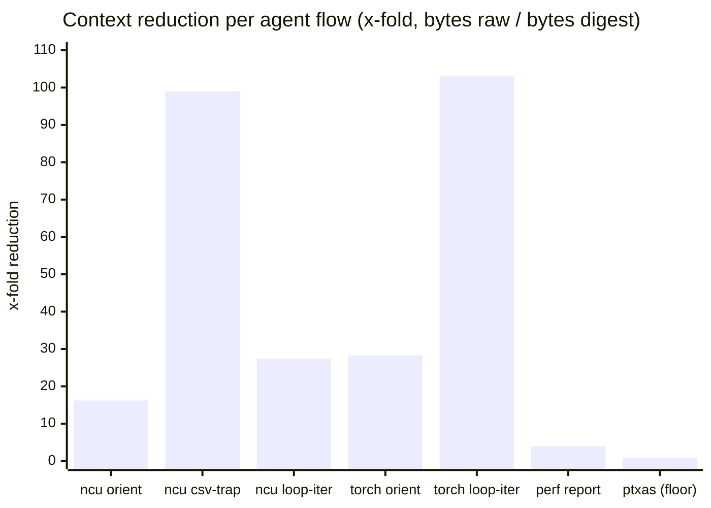

# Token-wise A/B — perfdigest v1.1.0-rc, four backends, real captures

Successor to [`RESULTS.md`](RESULTS.md) (which measured the NVIDIA path of
v1.0.0). This run measures the **payload entering an agent's context** across
**four backends** on real captures from this host, including the v1.1.0
agent-loop tools (`summarize_report`, `compare_metrics`) that did not exist in
v1.0.0.

## Subject & method

| | |
|---|---|
| perfdigest under test | **v1.1.0-rc** (main `dff3d19`, local build — PyPI still serves 1.0.0, which lacks summarize/compare) |
| Host | ASUS TUF A14 — Ryzen AI 9 HX 370 + RTX 4060 Laptop (sm_89) |
| Capture tools | `ncu` 2026.2, `perf` 7.0.0 (`perf_event_paranoid=2`), `nvcc` 13.3, torch 2.12.1+cu132 |
| Date | 2026-07-11 |

**A-arm (perfdigest):** byte length of the exact JSON the MCP tool returns
(compact separators), measured by calling the tools on the real reports.
**B-arm (raw):** byte length of the text an agent would otherwise read into
context for the same question. Tokens ≈ bytes / 4 (same estimate convention as
`RESULTS.md`). Workloads: [`workloads/gpu_bench.cu`](../workloads/gpu_bench.cu)
(2 kernels, `ncu --set full`, 25 MB `.ncu-rep`),
[`workloads/cpu_bench.c`](../workloads/cpu_bench.c) (perf stat + record), the
same `gpu_bench.cu` under `nvcc -Xptxas -v`, and a torch Kineto trace
(4× `relu(a@b)` + `sum` on CUDA, 130 events, 34 KB).

## Results — payload per agent flow (bytes, ~tokens)

### NVIDIA `ncu` (25 MB binary report, 2 kernels)

| Flow | raw read | perfdigest | reduction |
|---|--:|--:|--:|
| Orient in the report | `--page details` text — 22,676 B (~5,669 t) | `summarize_report` — **1,396 B (~349 t)** | **16.2×** |
| Full dump an agent might `cat` | `--csv --page raw` — 138,137 B (~34,534 t) | same 1,396 B | **99×** |
| One measure→edit→measure iteration | 2× details — 45,352 B (~11,338 t) | `compare_metrics` — **1,657 B (~414 t)** | **27.4×** |
| Deep-dive one kernel | (details again) | `get_metrics` — 657 B (~164 t) | — |

### torch / Kineto `chrome-trace` (34 KB trace, 15 units) — new in v1.1.0

| Flow | raw read | perfdigest | reduction |
|---|--:|--:|--:|
| Orient in the trace | trace JSON — 34,277 B (~8,569 t) | `summarize_report` — **1,212 B (~303 t)** | **28.3×** |
| One op deep-dive | (trace again) | `get_metrics("aten::mm")` — 289 B (~72 t) | — |
| Loop iteration | 2× trace — 68,554 B | `compare_metrics` — **664 B (~166 t)** | **103×** |

A toy 4-iteration profile is 34 KB; real training-step traces run to tens of
MB, where the raw arm stops fitting in a context window at all — the ratio
grows with trace size while the digest stays O(top-N).

### Linux `perf` (CPU)

| Flow | raw read | perfdigest | reduction |
|---|--:|--:|--:|
| Program counters | `perf stat -j` — 1,179 B | `get_metrics` — **518 B (~130 t)** | 2.3× |
| Hot symbols | `perf report --stdio` (default, callgraph) — 6,272 B (~1,568 t) | `summarize_report` — **1,573 B (~393 t)** | 4.0× |
| The trap an agent can fall into | `perf script` full dump — **12,393,541 B (~3.1M t)** | same 1,573 B | **7,879×** |
| Loop iteration (stat) | 2× 1,179 B | `compare_metrics` — 1,398 B | 1.7× |

Honest footnote: a human who knows the exact flags
(`--no-children -g none --percent-limit 0.5`) can get a flat report down to
688 B — *smaller* than the digest. perfdigest's value on this backend is not
raw compression; it is that the agent gets the normalized vocabulary without
knowing any flags, and can never `cat` the 12 MB `perf script` dump by mistake.

### `ptxas` codegen (684 B stderr, 2 kernels) — new in v1.1.0

| Flow | raw read | perfdigest | reduction |
|---|--:|--:|--:|
| All kernels | ptxas stderr — 684 B | `summarize_report` — 833 B | **0.8× (digest is bigger)** |
| One kernel | (stderr again) | `get_metrics` — 422 B | 1.6× |

Reported as measured: on an artifact this tiny and already semi-structured,
the JSON contract **costs** ~150 bytes rather than saving any. The value here
is the *vocabulary* (`spill_stores_bytes` beside an ncu digest of the same
kernel), not compression. A tool that only ever reported wins would be lying
by omission — this row is the floor of the thesis, printed on purpose.

## The compounding picture



(The `perf script` 7,879× bar is off this chart's scale on purpose; the 12 MB
dump simply does not fit in a context window.)

An optimization loop compounds the per-iteration delta: 10 iterations on the
ncu path is ~113 K raw tokens of permanent context versus ~4 K digest tokens —
the raw arm stacks every turn, the digest stays flat. `compare_metrics`
(new in v1.1.0) is what turns the *two-report* iteration cost into one small
delta table instead of two full digests.

## Reproduce

```bash
# captures (workloads/ has the sources; see workloads/README.md for full flags)
ncu --set full --launch-skip 2 --launch-count 2 -o gpu_bench ./gpu_bench
LC_ALL=C perf stat -j -o cpu_stat.json -e task-clock,cycles,instructions,... -- ./cpu_bench
nvcc -O3 -arch=sm_89 -Xptxas -v -c gpu_bench.cu -o /dev/null 2> gpu_bench.ptxas.txt
# torch: profile a few steps, prof.export_chrome_trace('trace.json')

# A-arm: len(json.dumps(tool_result)) for summarize_report / get_metrics /
#        compare_metrics over each report (perfdigest >= 1.1.0)
# B-arm: wc -c on the raw text an agent would read:
ncu --import gpu_bench.ncu-rep --page details | wc -c
ncu --import gpu_bench.ncu-rep --csv --page raw | wc -c
perf report --stdio | wc -c ; perf script | wc -c
```
